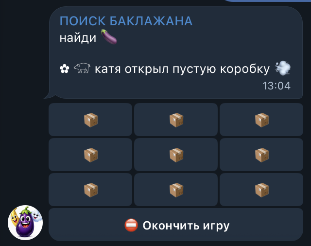

# Eggplant Hunt

A small multiplayer Telegram game built with Python, aiogram and aiohttp.
Players choose hidden boxes on a 3×3 board. The bot supports a shared group
game and a three-round duel with automatic scoring.

The user interface is in Russian. Documentation is in English.

## Demo

[Try the bot on Telegram](https://t.me/FindEggplant_bot)



## How to play

- `/game`: create a board. Each participant gets one pick. Different players
  may choose the same box. Picks are reported in the chat; boxes stay hidden
  until a participant presses the end-game button. Any participant can end it.
- `/duel`: two players join and each picks one box per round. The board is
  revealed for five seconds before the next round starts. An eggplant earns
  1 point, a golden banana 5, and an empty box 0. Highest total after three
  rounds wins; equal scores produce a draw.

Boards contain nine cells, at most one golden banana, and more empty cells
than eggplants. Gold probability is sampled uniformly between 0% and 5%
per board, giving an average probability of 2.5%.

## Local setup

Requires Python 3.10 or newer and a Telegram bot token.

## Code structure

```text
bot.py              Telegram handlers, keyboards, session cleanup, startup
game.py             Board generation, move validation, duel scoring
tests/              Offline game and handler tests
.env.example        Environment variable template without credentials
requirements.txt    Direct application dependencies
```

